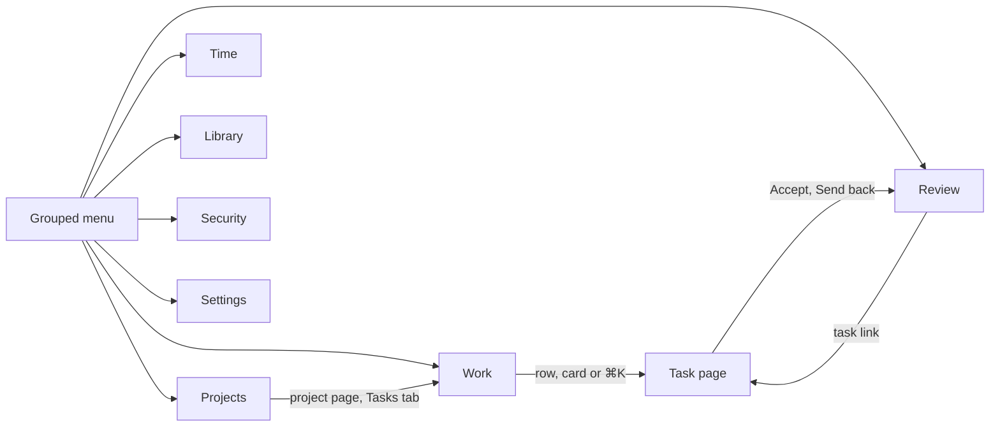

# Console design

## The report

The weekly and monthly report is a regrouping of the sessions the timer writes, and it is built
in the browser rather than behind an endpoint of its own. Everything it needs is already in the
window: the sessions, the tasks and the companies are loaded whole at startup, so a report is a
question about data that has already arrived rather than a new one to ask the server. The
grouping is a pure function over them, `common/report/time-report.ts`, which is what makes the
arithmetic testable without a database.

A session counts on the local day it started on, which is the rule the calendar already uses, and
one still open counts up to now. Both are the readings a person checking a total against their
own memory of the week would make.

The company filter holds ids, and an empty selection means every company rather than none. The
chips are built from the unfiltered period, so narrowing to one client never removes the way back
to the others.

## Structure

The console has no permanent task list and no fixed columns. A person moves between screens grouped
under one menu, all inside one shell: the header, the page, and the sessions dock at the bottom left.

The mockup in `.impeccable/mocks/redesign/app/index.html` is the source of truth for layout,
hierarchy and the copy of labels. Open it in a browser: it is a static site with hash routes and
in-memory demo data. Its simulated session, which claims a step after a few seconds, is replaced
in the build by the terminal, session, run queue and usage stores. A number the mockup invents
(the filed total, lane totals, adherence counts) comes from the real source or is left out.

### Page frame

Every screen is a page header, optional tabs and a body, and the body is always as wide as the window: no screen is held to a centred column. A body is a ledger (a table whose title column takes what the others leave), a workbench (an index beside the main area, with an optional inspector), a grid of cards that adds columns as the window grows, or a form grid (`form-grid`: `FormPanel` cards side by side, each setting a `FormRow` with its name and hint on the left and its control on the right). Only prose is centred, and only inside a document pane that itself fills: the page-width menu (Narrow, Standard, Wide or Full, one choice for every document) sets the width of the text, and the editor's read view takes it from there. Form fields are never stretched across a wide window.

### Screen map

| Mockup route | Real route | Screen |
|---|---|---|
| `#/work` | `/` (`/work` redirects to it) | Work ledger |
| `#/work/board` | `/work/board` | Work board |
| `#/task/:id/:tab` | `/task/:id/:tab` | Task page, tab `description`, `plan`, `wrapup`, `notes`, `time` or `deviations` |
| `#/review/:key` | `/review/:key?` | Review queue |
| `#/projects`, `#/projects/:id/:tab` | `/projects`, `/projects/:id/:tab` | Project list, project page |
| `#/companies` | `/companies` | Companies |
| `#/connections/:id` | `/connections/:id?` | Connections |
| `#/time/report` | `/report` | Time report |
| `#/time/calendar` | `/calendar` | Calendar |
| `#/library/diagrams` | `/diagrams` | Diagram gallery and viewer |
| `#/library/claude` | `/claude` | Claude files |
| `#/security` | `/security` | Security |
| `#/settings/:section/:topic` | `/settings/:section?/:topic?` | Settings |

The routes that exist today keep their paths: the redesign changes what a screen shows, not where it
lives. `/` is the Work ledger instead of the three-column console, and `/review` and `/settings`
are new. A ledger row, a card and the sheet open the task page at `/task/:id/description`; a note in view
is part of the path (`/task/:id/notes/:noteId`). `/console` is the terminal host and nothing else: Open in terminal, the dock and a deep link to a
terminal show the session there, and a visit with no terminal open goes on to the task page of the task
in view, or to Work. The notes list, the steps, wrapup, description and deviation panes of the old
console are gone; their tabs are on the task page.

### The grouped menu

The Rekall mark to the left of the menu key opens Work with the scope reset to All work.

The menu key in the header is three lines, the name of the screen on display, the alert total and a chevron
(`AppNavMenu`, `nav-menu-label`); it opens every screen under its section:
Work (Work, Review), Projects (Projects, Companies, Connections), Time (Report, Calendar), Library
(Diagrams, Claude files), Security and Settings. The review count rides on the Review entry, and the key's
accessible label names the screen on display and sums every alert. ⌘K opens the switcher:
Go to, Projects, Tasks (with their state or review count) and Notes, filtered by title or anchor,
and, for a phrase of three letters or more, an In the text group with what the server found in
descriptions, steps, wrapups and notes. It opens on every screen, from ⌘K or a click on the `/rk`
field (`CommandPalette`, mounted once by `Bootstrap`); a task opens its page, a note its Notes tab, a
step hit its Plan with the step open. It is how a person changes task, since there is no list to click.

## Work

Work is one table, the ledger, grouped by project. A project heading carries its mark, its name,
the company beside it, the task count, how many wait for review, and its tokens. The columns are
Task (the title, with a copy-anchor button shown on hover), Status (a pill), Plan (the plan tube
and done over total), Needs you, Notes, Tokens and Updated. The anchor chip is not on every row.
Sorting is on Task, Needs you, Tokens and Updated.

An epic is a row of its own, drawn with the stacked-plates mark in the epic tone and a chevron that
folds the tasks it gathers: they are listed under it, indented on a thin rail, and nowhere else,
and its Plan column says how many there are and how many are done. A task whose epic is not
listed with it (another tab, or the epic is filed) keeps its place and carries the epic's name as
a chip. The grouping is `features/work/lib/epic-entries.ts`; which epics are folded is kept in the
Work store and not remembered.

The head is the scope bar shared with the project page (below): the project switcher as the title
and what to know about the scope. Under it, the composer and the views are one section, `TasksSection`,
that Work and a project's Tasks page share: the scope is its only input, and a
project in view (a project page, or Work narrowed to one) adds the plan adherence strip and drops the
project headers from the ledger. Only Work chooses the layout, since the layout is a route.

The composer (`TaskComposer`) is the one way to start work: one line that grows with the text, the
project's folder (or, across projects, a picker that defaults to the project worked on last) and a
split key. The key starts a quick task and opens its session; its menu, **Plan a task…**, opens the
New task dialog with the text as its title, as does `T`. With no folder the key is inert and says why,
and planning still works. The views are sub-navigation tabs with counts,
and at their right end the filter on title and anchor, the Ledger or Board layout toggle and a **View**
menu (`WorkViewMenu`) with the density (Comfortable or Compact) and whether quick tasks show; the
toggle and the filter stay on the board, whose tabs are lanes: **Needs me** (the default), Running, Open and Filed. The ledger lists 25 tasks a page (`lib/work-pagination.ts`, `WorkPager`): the pager under it says which
tasks the page holds out of how many and goes back to the first page when the view, the filter, the sort or
the scope changes. A
finished task never fills the table: each project folds its `DONE` tasks into one `N filed` line
that opens in place. The rules for which tasks a tab shows, the counts, the sort and the fold are
pure functions in `features/work/lib/work-view-rules.ts`, over the rows `work-rows.ts` builds. Scope,
view and density are layout preferences kept in `localStorage` by `common/config/work-preferences.ts`;
the sort and the filter are not.

**Needs me** counts claimed steps plus tasks handed in whole. With nothing narrowing the scope that
number is the same one as the menu badge, the header review segment and the Review queue, and the
tests hold the two to each other. A scope narrows the tab counts to its tasks, so a count never
promises rows the table does not list.

A row carries three actions that do not open it. The status pill is a menu (`TaskStatusMenu`, the
same one the task page's properties bar uses): the pill says what the work is doing now, the menu
marks the stored status, and a change keeps the row listed for a moment like an accept. The arrow
at the end of the row opens the task page in one press, and the trash key that ends it deletes the
task behind the same confirm the task page uses (`TaskDeleteButton`, which stays in the list). A quick
task wears a `Quick` badge beside its title.

A row expands in place, one at a time, to its **peek**: the task's `/rk` anchor with copy, up to
three claimed steps each with Send back and Accept, a task handed in whole with Accept task and
Send back, Open task, and the session key (`OpenTerminalButton`, which reads Run here, or Working while
a session runs). A person can clear a task's claims without leaving Work.

Accepting stamps the step's seal in place and keeps the row listed for a moment, so the arrival is
seen before the task leaves a tab it no longer belongs to; every count updates at once. The toast
offers Reopen. Sending back has no Undo: only a session can claim a step again.

### Board

The board is a layout toggle of Work. Its lanes are To do, In progress (a running task wears the
session mark), Awaiting your review (the amber one) and Filed, collapsed to a shelf with a count. A
card is the project mark, a two-line title, the plan tube and one footer line. A card opens a 600px
sheet over the board with the same peek and Open as page; Escape or a click outside closes it. The
board and the ledger agree on every task and count: To do holds the to do and backlog tasks, In
progress the in-progress, running and blocked ones, and together with Awaiting your review they
hold exactly what the ledger lists on Open (`lib/work-lanes.ts`). A lane lists its first forty cards
and says how many more there are. The layout is the route, `/` for the ledger and `/work/board`
for the board.

## The task page

A task is a page at `/task/:id/:tab`, opened on its Description when no tab is named. The page
is as wide as the window. The page-width choice (Narrow, Standard, Wide or Full, from the key at
the right of the tab strip; Wide at first) sets only how wide the description editor is, centred
in the page; the choice is kept in the browser and holds for every task. The header is two lines: the breadcrumb (Work,
then company and project) with the task's actions at its right (Log commit, Open in terminal and
Run here, each offered once), and the title alone beneath. The tab strip is Description, Plan,
Changes, Wrapup, Notes, Time and Deviations, with counts where a count means something (steps,
logged commits, notes, deviations) and an amber one on Plan while a step waits for review; at its
right is the width key.
Beside every tab sits the properties bar (`TaskRail`), 272px wide, folding to an icon bar that the
browser remembers. Plan keeps its own choice and starts folded, so the steps and the step being read
have the width; the other tabs start open. Open, it holds: the status pill that changes the status and the copyable `/rk` anchor on top,
then Labels (tag, skills, dependencies), Context (what `/rk` hands a session, as a total and a bar of
its heaviest parts, with the tokens the task generated) and Git (the branch and the commits, shown
only while there is one). The Description tab keeps one strip: its views, Fix wording and Write/Read.

**Plan** is one row over a workspace. The row (`PlanBar`) spans the tab, never folds and stays
whatever is selected or whichever view is open: the plan tube with the line that says who has to
act (and the drafts still to promote), the adherence figures as one line (accepted first time, sent
back, deviations, and the budgets spent when a flow has spent any), then Hide done (the list view
only), Review next and List or Flow (when the steps have routes). The line of figures opens
**Plan adherence** as a panel over the workspace, at full size: its three figures with the help
line, and a flow's visits against each budget. It takes no height while it is closed and closes on
Escape or a press outside.

Under it, with the list view, the left zone is the step list, a column of 420px that keeps its
width whether or not a step is selected. A row is the step's seal, its number and its title (two
lines before it is cut), and under the title where the step stands (claimed or done and when,
working now, open) with one bar for each pass at it: yellow for a pass sent back, green for the one
accepted, indigo for the one a session has in hand. The hover keys (Accept or Done, New session, To
draft, move, delete) lie over the end of the row instead of taking a column. Under the rows come
the drafts with Promote and the line, docked at the foot, that adds a draft (a new step is a draft).

With the flow view the graph owns the whole workspace beside the picked step's routes and visits (a
column of 340px). It opens fitted to the canvas; a flow of more than six ranks wraps into columns of
equal height, read down and on to the right, with the routes that cross columns drawn out of the
sides that face each other. Over the canvas, at the top left, the count of moves opens the list of
them (each step the work entered with its move number and the outcome it left by, the open one
last, and Reset moves at its foot); at the top right are Tidy layout (once a step was moved), zoom
out and in with the level between, and Fit. Zooming holds until Fit is pressed.

The right zone is one frame with two fillings, so nothing moves when a step is chosen. Its header
holds a lead mark, a title, the keys for the previous and next step (the J and K keys do the same,
except while typing) and for hiding the list so the step has the whole tab, and under it one line
of facts. A step's header, body and dock follow the page width (Narrow, Standard, Wide or Full),
centred in the pane; the key for it sits among the header's keys as well as at the right of the tab
strip, and Full gives the detail the whole pane, so hiding the list widens it. The detail has no
second width menu, since the page width is the one setting for it. The overview alone is held to 76rem. A dock at the foot holds the keys
of a decision still to be made. Pinned, the header and dock stay while the body scrolls.

With no step selected, which is how the tab opens, the frame holds the **overview**: its title says
what waits for you ("1 step waits for you"). Under it a line of notices shows the drafts to
promote and the deviations, when the task has them; then the review queue (Waiting for you,
Working now, Up next, and Accepted, which opens by itself when nothing else is left), each row a
step with what it holds (checks passed, commits, pass and claim time for a claim); then the flow to
lay when the task can take one. The dock holds Review next, and Accept all once only claims are
left, and is absent when nothing waits.

With a step selected, the frame holds its **decision**. The title is renamed in place: pressing it
turns it into a field, saved as it is typed. The facts line says the state (a pill), the place, when
it last moved, the pass, and the checks and commits as buttons that open the evidence; a deviation
and, while a session runs or after it claimed, Log commit follow. At its end sit the Write and Read
switch, Reopen on a done step (which asks twice) and Overview (Esc does the same). The body is the
sealed passes hung on one line like a history, then the detail, or the feedback for the next pass
once the step was sent back, taking the whole width: prose, tables, diagrams and code blocks all
fill the pane. Under the detail come the
skills the step runs with and the checks it has to pass, side by side, which a finished step shows
only if it carries checks. The evidence (the last run of each check, the commits) is a drawer under
the header, open on a claim and on a failed check and folded otherwise, so no column is kept for
it. With the list hidden on a pane 1100px wide or more, the page gains a rail beside the detail
that holds the history of the step (created, each send-back, the session, the claim, the
acceptance), the evidence and the setup, and the chips stop being buttons. The dock holds Accept
and Send back on a claim, and the session key and Mark done myself on an open or running step; a
done step has none. A task handed in whole shows its own decision, Accept task or Send back, in
the same place. Nothing but a person marks a step done, and Claude moves a step only up to
claimed. The list and the frame share the step editor, so a title or detail typed in the frame is
saved as it was in the old checklist.

**Changes** reads what the sessions changed in the application as a code review (`TaskChangesTab`,
data from `GET /api/tasks/{id}/changes`). A track along the top picks what is compared: **All changes**
(each file as the logged commits left it), a **repository** (only when the task changed more than
one), a **step** (the commits logged against it), one **commit**, or a **working tree** a session has
not committed yet (indigo, with a pulsing dot), one per repository. A file tree on
the left lists every file of the task as folders that open and close, with its added and removed lines in
the chosen scope (a folder shows the sum of the files below it); a folder that holds only another
folder reads as one element (`rekall-core/src/commit/model`), as an IDE compacts empty packages, and
the arrow keys move through the rows and open or close a folder;
a file the scope does not touch stays listed as "not in this" and opens All changes when pressed.
With several repositories the tree and the column open each group with the repository's name and
its own totals; with one, nothing is added. Files are told apart by repository and path.
The column on the right is one continuous diff with a sticky header per file: **Split** (old file
beside new) or **Unified**, real old and new line numbers, the words an edit changed marked inside
a changed line, and keyword and comment weight with no new palette. In All changes and a step each hunk
carries a chip with the commit, step and subject that made it, and pressing it reads that single
commit; in a single commit a file also touched by other commits says whether they came earlier or
later and links back to the net result. **Viewed** is the reader's own mark: it folds the file and
counts in "N of M viewed", kept in the page only, and accepts nothing. Keys: `j` and `k` between
files, `v` viewed, `u` split or unified, `a` all changes. Unchanged lines between hunks are not
expandable, and an epic has no Changes tab.

The other tabs hold the panes the console had, with the title row left to the page header. Wrapup
keeps its author and age, the freshness tag, Versions, Wrapup here and the editor. Notes is a list
of the task's notes (a ring marks one loaded on request, Add information, Delete) beside the note
pane. Description keeps the review bar, Fix wording and the revisions; on a task that belongs to an
epic a card names the epic, and an epic's page has no Plan and opens on its shared description with its tasks, oldest first and each with its status, in a column beside it. A task's page offers **Convert to epic**, which lists what is carried over and what is deleted before it converts. Time shows tracked time, sessions and tokens with the timer and the log of sessions.
Deviations opens on the first and walks them by step. A task selected elsewhere (search, the review
queue) is followed to its page, on the tab that shows the pane it asked for.

## Review

Review is its own screen at `/review/:key?`: a queue of every claimed step and every task handed in
whole, the longest waiting first, beside the same decision panel as Plan. The queue is the
console's `reviewQueue`, so its length is the Needs me count, the badge on the Review entry of the
menu and the header review segment, which is a link to this screen (the popover list it used to
open is gone). The item in view is in the URL; after a decision the item leaves the queue and the
next one in its order opens, or the one before it at the end. Under the panel sits the task's
adherence (steps accepted at the first pass, sent back, deviations) from the real adherence data.
With nothing waiting the screen says "Nothing waits for you." over the large done seal. The
shortcuts A, S and J/K shown by the mockup are a proposal and are not built until they are
approved.

## The other sections

**Projects.** Projects, Companies and Connections share one sub-navigation with counts
(`ProjectsSubNav`). The list is a card per project under its company, with the identity mark, anchor,
status pill, a composition bar (filed, to review, in progress, to do: `lib/project-composition.ts`)
and counts. The project page opens with the same scope bar as Work and a header that is the same on every working
screen, the `/rk` search and the status capsule (`ConsoleHeader`). The title is the project switcher
(`ScopeSwitcher`): a search field, the projects opened last (`recentProjects.store`, five kept in
`localStorage`, three shown), then every company with its projects, archived ones left out unless open.
On Work a choice narrows the list (All work, a company or a project) and a project row carries **Open page**;
on a project page a choice goes to that project on the tab already open. What each page does with a choice
is the page's; the switcher only hands back a `ScopeTarget`. The project page is a route per tab (`/projects/:id/:tab`): Tasks (the Work ledger
narrowed to the project through `work.focusProject`), Blueprint, Pages, Components, Diagrams,
Deployment, Connections and Settings; Blueprint and Deployment keep what the old page held beyond
the mockup's six. Companies is a list with a detail pane (`/companies/:id`); Connections are grouped
by kind with Check and the credential reveal. The company is named beside a project on the cards'
group, the project page, a company's detail and the ⌘K palette.

**Time** has the Report and the Calendar behind one sub-navigation; the grouping stays
`common/report/time-report.ts`. **Library** has Diagrams (a gallery grouped by project, and the
viewer with the Walkthrough) and Claude files (a tree of Memories, Skills, Commands and Agents with
an editor). **Security** is the overview with its alert banner, the Needs attention list and the
project rail. **Settings** is a screen at `/settings/:section?/:topic?` with a sticky rail of sections in four groups and the key `Settings` in the
menu. Workspace: General (the databases), Connections (a link to the screen), Data and backup. Work: Sessions and run queue
(Claude Code and its protections), Review (open the next item after a decision, confirm before sending work back), Time and usage
(the workday goal the report's dashed line reads, the percentage the usage meter warns from), Notifications. Console: Appearance
(density, which is the Work ledger's, motion, text scale), Keyboard. Reference: Help and About. Help lists its topics (Load, Tasks,
Steps, Wrapup, Notes and pages, Revisions, Diagrams, Security, Outside Rekall) under its own rail entry, each a `:topic` address:
the `/rk` commands of the topic with the MCP tool each calls, the tools a session can be asked for directly, and for a session
outside Rekall requests to paste. Project label and Task code fill every command and request, and a search finds across topics;
the catalog is `settings/model/help-context.ts`. The browser-side choices live in `usePreferencesStore`, saved in
`localStorage` through `common/config/ui-preferences.ts`: Reduced motion sets `data-motion` on the
document, where the stylesheet drops the loops and keeps every state change; the text scale is the
document's font size; every send back goes through `sendBackGuard`. A session's concurrency, terminal
command and retention have no home in the server's settings and are not offered.

Every screen shares the ledger vocabulary: the status pill, the plan tube, anchors as copy buttons,
sub-navigation tabs with counts, the step seal and the same motion. Reduced motion drops the loops
(the running comet, the tube sheen, the orb pulse) and keeps every state change visible.

## Labels

The kicker above a title, "Description", "Time", "Tracked this week", a form-section label in a
dialog, a company name in the scope popover, was tracked-out capitals everywhere. It is now
ordinary case in the shared `eyebrow` utility, a hair of tracking and nothing more, so it names
its section without shouting over the content beneath it. In the writing tabs of a task (Wrapup,
Notes, Description) it is preceded by a 3px accent tick, the same mark on all of them, which is how
you tell at a glance which surface is on screen. Raw status enums that used to be printed as-is
(`PAUSED`) now go through their label map (`Paused`) wherever they are shown.

The filed tone is a muted verdigris, `--color-filed`. It is deliberately neither the green of a
live `DONE` status nor the grey of disabled chrome: a shelf of finished tasks should read as an
archive, not as a list that has gone dim.

A tag badge (`tag-chip`) is the tag picker's quiet key: a neutral face warmed a few percent by the
tag's colour, a tinted hairline, and the colour itself carried by the glowing icon.

## Skills

A skill is a chip, `name · arguments`: the name in monospace, the arguments after a dim dot in
the text face, cut with an ellipsis before the name is (the name keeps its width, up to 26
characters) and whole in the chip's tooltip. The task bar, the step panel, the new-task dialog,
the tag editor and the line that adds a step all draw the same chip, so a skill reads the same
wherever it is assigned. A skill the owner holds is a solid chip: its name and arguments are one
button that opens the catalogue on that skill's arguments, and its cross takes the skill off. A
skill a wider scope already brings (the task's and the tag's, on a step) is a dashed chip that
shows its arguments too, and is read-only: changing it is done where it is assigned.

The catalogue is the one place a skill is chosen. Ticking a row opens a field under it, "Arguments,
optional", capped at 300 characters like the server; unticking removes the skill with its
arguments. Ticking is a save of the owner's whole list, but arguments are saved when the field is
left, on Enter, or when the panel closes, never per keystroke: Enter ends the typing and gives
the keyboard back to the filter, it does not tick the highlighted row. A blank field is no
arguments. Opened from a chip, the panel puts the keyboard on that skill's field. A skill that is
no longer under `~/.claude` is listed on top with its own field, so its arguments can still be
read and changed. A name a wider scope brings is ticked and locked ("already on the task") unless
the owner also holds it, in which case it is an ordinary row: the same skill with other arguments
is its own invocation.

The panel hangs from its button, above it when the button sits low, 380px wide and never wider
than the screen less its gutters, so on a phone the field spans the row under the ticked skill.

## Tokens, not values

Every size, corner, grey and tempo a component uses is a token in `main.css`, because values
picked one component at a time drift: the console had reached twenty-two font sizes, half of them
half a pixel apart.

| Token | Steps | Rule |
|---|---|---|
| Type, `text-micro` … `text-hero` | 11, 11.5, 12.5, 13.5, 15, 19, 26, 34 px | Micro is the floor and never prose. Body leading is 1.4; text inherits it, and the markdown panes set their own |
| Corners, `rounded-key` / `-control` / `-card` | 3, 5, 8 px | A button, chip or kbd; a field, row or icon square; a card, dialog or header capsule. A status pill, a dot, a switch or a gauge is `full`: a state never has a key's shape |
| Relief, `--shadow-key` / `--shadow-raised` | lip + contact; + a short cast | A key is a flat face with a one-pixel edge, a lip and a contact shadow; a raised card adds a short soft cast. Surfaces carry no gradient, inner shade or halo |
| Tempo, `--motion-press` … `--motion-slow` | 90, 140, 220, 320 ms | Press, hover, a pane moving, a seal. Choreographed keyframes keep their own |
| `--color-text-subtle` | `#8c96a6` | 4.5:1 up to `surface-hover`, so small hints stay readable. Never faded further with an opacity modifier |
| `--color-border-field` | `#5e6a82` | The edge of something you type into, 3:1 against the field's canvas fill; hairline separators keep `border` |

`tests/unit/design-tokens.spec.ts` fails on a bracketed font size or radius, a faded subtle grey,
a pixel `font-size` in a style block or a numeric `duration-*`. `TerminalPane.vue` is exempt: it
frames a real terminal and is left as it is.

Two components carry what every screen repeats. `AppDialog` is the one modal shell (backdrop,
`role`, `aria-modal`, Escape, focus trap and the modal gate); `common/a11y/dialog-stack.ts` makes
only the dialog on top answer the keyboard, so a confirm over a panel closes alone, and a dialog
that is not dismissible lets Escape through to the control inside it. `AppButton` adds `quiet`,
an `icon` size and `pressed`, which lights a toggle as `key-lit` and sets `aria-pressed`, so
toolbar keys stop being hand-built from the keycap utilities. A control drawn smaller than 24px
takes `hit-target`, which grows the pointer target, not the glyph.

The header is one 48px row (`--spacing-header`), a three-cell grid. The left cell holds the 24px
mark, the menu key and the history arrows. The menu key is a bare three-line burger that opens every screen
grouped under its section (`AppNavMenu`); its accessible label names the screen on display and sums
the alerts, and each alert shows beside its entry. The centre cell, at most 620px, is the
`/rk` field: at rest it shows the open task's or project's anchors as chips, and `⌘K` or a click opens
the switcher. The right cell is one 36px `header-capsule` with the field's corner, usage, the run
queue and the review count (`HeaderStatus`, segments drawn with `status-segment`), where review is
the only amber segment because it is the only one asking for action; beside it the save dot, Tags
and Settings (`header-key`). The save state is a dot whose word is for screen readers and the
tooltip. The bar gives way under 1280px: the anchors keep only the last one and the review segment
drops its words; under 1100px the `⌘K` hint goes. The usage segment opens the usage detail and the
queue segment opens the list of queued and running tasks.

The run queue shows a task's steps in two places, from one value (`runProgress(queue).steps`: the
steps that count, how many are settled, the current one; a claim settles a step because the queue
never waits for acceptance). The 22px `RunDial` replaces its comet with a ring of one slice per
step (`stepRing`, a pure geometry helper): settled in the accent, the current one in the lighter
`accent-strong` and pulsing in opacity on the 1.7s beat (the lighter tone alone marks it under
`prefers-reduced-motion`), the rest `border-field` hairlines, which hold 3:1 against the bar, and
one proportional arc above 12 steps. `QueueBead`'s open and not-needed rings use the same token. In the panel `QueueStepList` nests under the task row, title and
state only, with `QueueBead`'s marks; a not-needed step is a dashed ring with its title muted, and
claimed and accepted steps share a mark but are named apart for a screen reader. The disclosure
that opens it carries `aria-expanded`/`aria-controls` and a 44px hit area.

The calendar (`CalendarPage`, `CalendarDayCell`) heads each day with its total and a load bar:
its length is the day against an eight-hour day, its segments the projects largest first
(`common/calendar/day-shares.ts`). An eighth column totals each week; today wears an amber ring.

## The chat window

A chat session (a headless `claude`, see [terminals.md](terminals.md)) is shown in a window docked
beside the page, not in the terminal pane: there is no terminal to draw, so the window draws the
session's events. Everything lives in `rekall-ui/src/features/chat/`. The store folds each event into
a timeline by `seq` (`foldEvent`, idempotent, so a reconnect that replays an event changes nothing),
and one `EventSource` per followed session (`useChatEvents`) feeds it. A chat never becomes the
terminal pane's active session; that pane and the Diagrams and Security drawers list terminals only.

The window docks in one of four modes (`chatDock.store`): `inline` beside the note pane while the note
keeps 360 px, `overlay` when it would not, `full` when expanded, and `hidden`. Its width runs from
360 to 720 px and is remembered with the hidden flag, per viewer, in `localStorage`. On any page
but the console it always overlays. It belongs to a task: it shows only on the task its session
runs on (or on the one that asked for it with no session yet), and disappears when another task is
selected (`useChatWindowShown`, `chat.sessionFor`). A session on no task, such as one generating a
diagram for a project, stays on screen. A chat opened from a button brings itself to the window
(`useRevealOpenedChat`).

An approval is never answered or expired on the user's behalf: `ChatApprovalCard` shows the call
(with a diff for an edit) and stays until a `permissionResolved` event arrives. Whether the session is
waiting is read from its own timeline once it is followed, because the flag on the stored session
list is only refreshed on load and focus and would go stale after the answer. Stop sends the
interrupt and the session keeps answering.

`C` hides or shows the window when a chat is active, the task has one, or the session view is Chat;
`Shift+C` shows it expanded; in all other cases `C` keeps opening the terminal pane. In the window,
`Y` allows and `N` denies the pending call, `Enter` sends, `Shift+Enter` breaks the line, and `Esc`
returns focus to the note pane. The dock's divider resizes with the arrow keys (16 px, 64 px with
Shift).

## Scroll lanes

A page, or a pane that swaps its content for another (a tab, a view), scrolls with `page-scroll`
(`overflow-y: scroll` and a stable gutter) instead of `overflow-y-auto`, so its scrollbar's lane is there
before the content needs it. With `auto`, a short tab and a long one differ by the lane's width and the
centred column shifts sideways when the scrollbar comes or goes; the desktop's web view does not always
honour `scrollbar-gutter` alone, which is why the utility also forces the scrollbar.
