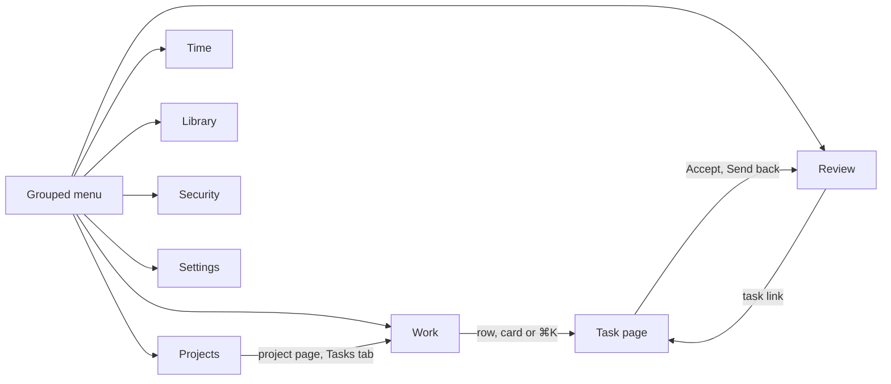

# Console design

## The report

The weekly and monthly report is a regrouping of the sessions the timer writes, and it is built
in the browser rather than behind an endpoint of its own. Everything it needs is already in the
window: the sessions, the tasks and the companies are loaded whole at startup, so a report is a
question about data that has already arrived rather than a new one to ask the server. The
grouping is a pure function over them, `common/report/time-report.ts`, which is what makes the
arithmetic testable without a database.

A session counts on the local day it started on, which is the rule the calendar already uses, and
one still open counts up to now. Both are the readings a person checking a total against their
own memory of the week would make.

The company filter holds ids, and an empty selection means every company rather than none. The
chips are built from the unfiltered period, so narrowing to one client never removes the way back
to the others.

## Structure

The console has no permanent task list and no fixed columns. A person moves between screens grouped
under one menu, all inside one shell: the header, the page, and the sessions dock at the bottom left.

The mockup in `.impeccable/mocks/redesign/app/index.html` is the source of truth for layout,
hierarchy and the copy of labels. Open it in a browser: it is a static site with hash routes and
in-memory demo data. Its simulated session, which claims a step after a few seconds, is replaced
in the build by the terminal, session, run queue and usage stores. A number the mockup invents
(the filed total, lane totals, adherence counts) comes from the real source or is left out.

### Screen map

| Mockup route | Real route | Screen |
|---|---|---|
| `#/work` | `/` (`/work` redirects to it) | Work ledger |
| `#/work/board` | `/work/board` | Work board |
| `#/task/:id/:tab` | `/task/:id/:tab` | Task page, tab `plan`, `wrapup`, `notes`, `description`, `time` or `deviations` |
| `#/review/:key` | `/review/:key` | Review queue |
| `#/projects`, `#/projects/:id/:tab` | `/projects`, `/projects/:id/:tab` | Project list, project page |
| `#/companies` | `/companies` | Companies |
| `#/connections/:id` | `/connections/:id?` | Connections |
| `#/time/report` | `/report` | Time report |
| `#/time/calendar` | `/calendar` | Calendar |
| `#/library/diagrams` | `/diagrams` | Diagram gallery and viewer |
| `#/library/claude` | `/claude` | Claude files |
| `#/security` | `/security` | Security |
| `#/settings/:section` | `/settings/:section` | Settings |

The routes that exist today keep their paths: the redesign changes what a screen shows, not where it
lives. `/` is the Work ledger instead of the three-column console, and `/task`, `/review` and
`/settings` are new. Until the task page exists, a ledger row opens the task in the old two-pane
console, which lives at `/console`.

### The grouped menu

The menu key in the header names the screen on display and opens every screen under its section:
Work (Work, Review), Projects (Projects, Companies, Connections), Time (Report, Calendar), Library
(Diagrams, Claude files), Security and Settings. The review count rides on the key and on the
Review entry, so folding the menu never hides what waits for the person. ⌘K opens the switcher:
Go to, Projects, Tasks (with their state or review count) and Notes, filtered by title or anchor.
It is how a person changes task, since there is no list to click.

## Work

Work is one table, the ledger, grouped by project. A project heading carries its mark, its name,
the company beside it, the task count, how many wait for review, and its tokens. The columns are
Task (the title, with a copy-anchor button shown on hover), Status (a pill), Plan (the plan tube
and done over total), Needs you, Notes, Tokens and Updated. The anchor chip is not on every row.
Sorting is on Task, Needs you, Tokens and Updated.

The head holds the scope select (all work, a company, or a project), a filter on title and anchor,
the Ledger or Board layout toggle, the density (Comfortable or Compact) and New task. Under it the
views are sub-navigation tabs with counts: **Needs me** (the default), Running, Open and Filed. A
finished task never fills the table: each project folds its `DONE` tasks into one `N filed` line
that opens in place. The rules for which tasks a tab shows, the counts, the sort and the fold are
pure functions in `features/work/lib/work-view-rules.ts`, over the rows `work-rows.ts` builds. Scope,
view and density are layout preferences kept in `localStorage` by `common/config/work-preferences.ts`;
the sort and the filter are not.

**Needs me** counts claimed steps plus tasks handed in whole. With nothing narrowing the scope that
number is the same one as the menu badge, the header review segment and the Review queue, and the
tests hold the two to each other. A scope narrows the tab counts to its tasks, so a count never
promises rows the table does not list.

A row expands in place, one at a time, to its **peek**: the task's `/rk` anchor with copy, up to
three claimed steps each with Send back and Accept, a task handed in whole with Accept task and
Send back, Open task, and Resume session or the running state. A person can clear a task's claims
without leaving Work.

### Board

The board is a layout toggle of Work. Its lanes are To do, In progress (a running task wears the
session mark), Awaiting your review (the amber one) and Filed, collapsed to a shelf with a count. A
card is the project mark, a two-line title, the plan tube and one footer line. A card opens a 600px
sheet over the board with the same peek and Open as page; Escape or a click outside closes it. The
board and the ledger agree on every task and count.

## The task page

A task is a page at `/task/:id/:tab`. Its header holds the breadcrumb (Work, then company and
project), the title, the status pill that changes the status, the copyable `/rk` anchor, tracked
time and tokens, Open in terminal, and Resume session or Watch the session. Under it the tabs are
Plan, Wrapup, Notes, Description, Time and Deviations, with counts where a count means something
(steps, notes, deviations) and an amber one on Plan while a step waits for review.

**Plan** is two zones. The left is the step list with the seals, a summary line with the plan tube,
Hide done, Review next, and the drafts under their own heading with Promote; a new step is a
draft. The right is the **decision panel** of the selected step: for a claimed step the claim, its
check results, Accept and Send back, and Up next to review; for a running one the Watch the session
key; for an open one Give to a session; for a draft Promote. Nothing but a person marks a step
done, and Claude moves a step only up to claimed. Wrapup shows the state text with its author and
age. Notes is a list beside a markdown reader and editor. Description keeps review and rewrite.
Time shows tracked time, sessions and tokens. Deviations lists them by step.

## Review

Review is its own screen at `/review/:key`: a queue of every claimed step and every task handed in
whole, the longest waiting first, beside the same decision panel as Plan. After a decision the
next item is selected. Under the panel sit the adherence counts (steps accepted, sent back,
deviations), read from the real adherence data. With nothing waiting the screen says "Nothing waits
for you." over the large done seal. The shortcuts A, S and J/K shown by the mockup are a proposal
and are not built until they are approved.

## The other sections

**Projects.** The list is a card per project under its company, with the identity mark, anchor,
status pill, a composition bar (filed, to review, in progress) and counts. The project page has
the tabs Tasks (the ledger scoped to the project), Pages, Components, Diagrams, Connections and
Settings. Companies is a list with a detail pane; Connections are grouped by kind with Test
connection and the credential reveal. A project name is never shown without its company.

**Time** has the Report and the Calendar behind one sub-navigation; the grouping stays
`common/report/time-report.ts`. **Library** has Diagrams (a gallery grouped by project, and the
viewer with the Walkthrough) and Claude files (a tree of Memories, Skills, Commands and Agents with
an editor). **Security** is the overview with its alert banner, the Needs attention list and the
project rail. **Settings** is a section rail: General, Appearance, Review, Sessions and run queue,
Notifications, Time and usage, Connections, Data and backup, Keyboard and About.

Every screen shares the ledger vocabulary: the status pill, the plan tube, anchors as copy buttons,
sub-navigation tabs with counts, the step seal and the same motion. Reduced motion drops the loops
(the running comet, the tube sheen, the orb pulse) and keeps every state change visible.

## Labels

The kicker above a title, "Description", "Time", "Tracked this week", a form-section label in a
dialog, a company name in the scope popover, was tracked-out capitals everywhere. It is now
ordinary case in the shared `eyebrow` utility, a hair of tracking and nothing more, so it names
its section without shouting over the content beneath it. In the writing tabs of a task (Wrapup,
Notes, Description) it is preceded by a 3px accent tick, the same mark on all of them, which is how
you tell at a glance which surface is on screen. Raw status enums that used to be printed as-is
(`PAUSED`) now go through their label map (`Paused`) wherever they are shown.

The filed tone is a muted verdigris, `--color-filed`. It is deliberately neither the green of a
live `DONE` status nor the grey of disabled chrome: a shelf of finished tasks should read as an
archive, not as a list that has gone dim.

A tag badge (`tag-chip`) is the tag picker's quiet key: a neutral face warmed a few percent by the
tag's colour, a tinted hairline, and the colour itself carried by the glowing icon.

## Tokens, not values

Every size, corner, grey and tempo a component uses is a token in `main.css`, because values
picked one component at a time drift: the console had reached twenty-two font sizes, half of them
half a pixel apart.

| Token | Steps | Rule |
|---|---|---|
| Type, `text-micro` … `text-hero` | 11, 11.5, 12.5, 13.5, 15, 19, 26, 34 px | Micro is the floor and never prose. No line heights: text inherits its leading |
| Corners, `rounded-key` / `-control` / `-card` | 3, 5, 8 px | A chip or kbd, a button, field or row, a card, dialog or header capsule. Pills are `full` |
| Relief, `--shadow-key` / `--shadow-raised` | lip + contact; + a short cast | A key gets a faint lit lip and a contact shadow, nothing cast; a raised card adds a short soft one. Depth is a hint, never an extrusion |
| Tempo, `--motion-press` … `--motion-slow` | 90, 140, 220, 320 ms | Press, hover, a pane moving, a seal. Choreographed keyframes keep their own |
| `--color-text-subtle` | `#8c96a6` | 4.5:1 up to `surface-hover`, so small hints stay readable. Never faded further with an opacity modifier |
| `--color-border-field` | `#5e6a82` | The edge of something you type into, 3:1 against the field's well; hairline separators keep `border` |

`tests/unit/design-tokens.spec.ts` fails on a bracketed font size or radius, a faded subtle grey,
a pixel `font-size` in a style block or a numeric `duration-*`. `TerminalPane.vue` is exempt: it
frames a real terminal and is left as it is.

Two components carry what every screen repeats. `AppDialog` is the one modal shell (backdrop,
`role`, `aria-modal`, Escape, focus trap and the modal gate); `common/a11y/dialog-stack.ts` makes
only the dialog on top answer the keyboard, so a confirm over a panel closes alone, and a dialog
that is not dismissible lets Escape through to the control inside it. `AppButton` adds `quiet`,
an `icon` size and `pressed`, which lights a toggle as `key-lit` and sets `aria-pressed`, so
toolbar keys stop being hand-built from the keycap utilities. A control drawn smaller than 24px
takes `hit-target`, which grows the pointer target, not the glyph.

The header is one 48px row (`--spacing-header`), a three-cell grid. The left cell holds the 24px
mark, the menu key and the history arrows. The menu key is a three-line burger that names the screen
on display, opens every screen grouped under its section (`AppNavMenu`) and carries the sum of the
alerts, the review count, so folding never hides a warning. The centre cell, at most 620px, is the
`/rk` field: at rest it shows the open task's or project's anchors as chips, and `⌘K` or a click opens
the switcher. The right cell is one 36px `header-capsule` with the field's corner, usage, the run
queue and the review count (`HeaderStatus`, segments drawn with `status-segment`), where review is
the only amber segment because it is the only one asking for action; beside it the save dot, Tags
and Settings (`header-key`). The save state is a dot whose word is for screen readers and the
tooltip. The bar gives way under 1280px: the anchors keep only the last one and the review segment
drops its words; under 1100px the `⌘K` hint goes. The usage segment opens the usage detail and the
queue segment opens the list of queued and running tasks.

The run queue shows a task's steps in two places, from one value (`runProgress(queue).steps`: the
steps that count, how many are settled, the current one; a claim settles a step because the queue
never waits for acceptance). The 22px `RunDial` replaces its comet with a ring of one slice per
step (`stepRing`, a pure geometry helper): settled in the accent, the current one in the lighter
`accent-strong` and pulsing in opacity on the 1.7s beat (the lighter tone alone marks it under
`prefers-reduced-motion`), the rest `border-field` hairlines, which hold 3:1 against the bar, and
one proportional arc above 12 steps. `QueueBead`'s open and not-needed rings use the same token. In the panel `QueueStepList` nests under the task row, title and
state only, with `QueueBead`'s marks; a not-needed step is a dashed ring with its title muted, and
claimed and accepted steps share a mark but are named apart for a screen reader. The disclosure
that opens it carries `aria-expanded`/`aria-controls` and a 44px hit area.

The calendar (`CalendarPage`, `CalendarDayCell`) heads each day with its total and a load bar:
its length is the day against an eight-hour day, its segments the projects largest first
(`common/calendar/day-shares.ts`). An eighth column totals each week; today wears an amber ring.

## The chat window

A chat session (a headless `claude`, see [terminals.md](terminals.md)) is shown in a window docked
beside the page, not in the terminal pane: there is no terminal to draw, so the window draws the
session's events. Everything lives in `rekall-ui/src/features/chat/`. The store folds each event into
a timeline by `seq` (`foldEvent`, idempotent, so a reconnect that replays an event changes nothing),
and one `EventSource` per followed session (`useChatEvents`) feeds it. A chat never becomes the
terminal pane's active session; that pane and the Diagrams and Security drawers list terminals only.

The window docks in one of four modes (`chatDock.store`): `inline` beside the note pane while the note
keeps 360 px, `overlay` when it would not, `full` when expanded, and `hidden`. Its width runs from
360 to 720 px and is remembered with the hidden flag, per viewer, in `localStorage`. On any page
but the console it always overlays. It belongs to a task: it shows only on the task its session
runs on (or on the one that asked for it with no session yet), and disappears when another task is
selected (`useChatWindowShown`, `chat.sessionFor`). A session on no task, such as one generating a
diagram for a project, stays on screen. A chat opened from a button brings itself to the window
(`useRevealOpenedChat`).

An approval is never answered or expired on the user's behalf: `ChatApprovalCard` shows the call
(with a diff for an edit) and stays until a `permissionResolved` event arrives. Whether the session is
waiting is read from its own timeline once it is followed, because the flag on the stored session
list is only refreshed on load and focus and would go stale after the answer. Stop sends the
interrupt and the session keeps answering.

`C` hides or shows the window when a chat is active, the task has one, or the session view is Chat;
`Shift+C` shows it expanded; in all other cases `C` keeps opening the terminal pane. In the window,
`Y` allows and `N` denies the pending call, `Enter` sends, `Shift+Enter` breaks the line, and `Esc`
returns focus to the note pane. The dock's divider resizes with the arrow keys (16 px, 64 px with
Shift).
